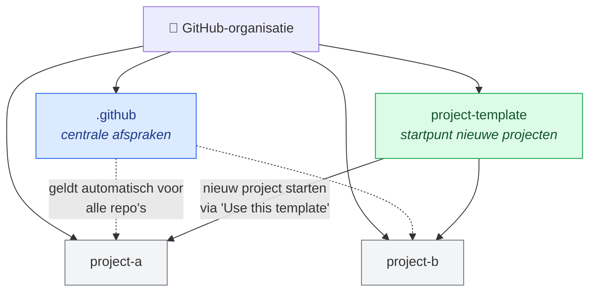
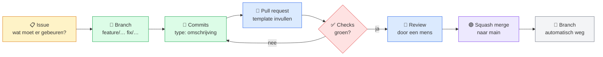

# Werkafspraken & bijdragen

> **Wat is dit?** De afspraken over hoe we in deze organisatie werken: van repo-naam tot commit-bericht en pull request.
> **Waarom?** Zodat elke repo er hetzelfde uitziet, we elkaars werk snel begrijpen en ook Claude en ChatGPT zich aan dezelfde regels houden. Geen chaos, wel overzicht.
> **Waar staat dit bestand?** In de root van de repo **`.github`** van de organisatie. GitHub gebruikt het daardoor automatisch voor **alle repo's** die zelf geen `CONTRIBUTING.md` hebben, en toont een link ernaar bij het aanmaken van issues en pull requests.

---

## Inhoud

1. [Hoe de organisatie is opgebouwd](#1-hoe-de-organisatie-is-opgebouwd)
2. [De werkwijze in één oogopslag](#2-de-werkwijze-in-één-oogopslag)
3. [Repo-naamgeving](#3-repo-naamgeving)
4. [Branches](#4-branches)
5. [Commit-berichten (NL & EN)](#5-commit-berichten-nl--en)
6. [Pull requests](#6-pull-requests)
7. [Issues & projectbord](#7-issues--projectbord)
8. [Codekwaliteit: JavaScript/React & Python](#8-codekwaliteit-javascriptreact--python)
9. [Werken met AI-tools (Claude & ChatGPT)](#9-werken-met-ai-tools-claude--chatgpt)
10. [Geheimen & beveiliging](#10-geheimen--beveiliging)
11. [Een nieuw project starten](#11-een-nieuw-project-starten)
12. [Bestandsoverzicht: wat staat waar en waarom](#12-bestandsoverzicht-wat-staat-waar-en-waarom)

---

## 1. Hoe de organisatie is opgebouwd

We gebruiken twee speciale repo's die de basis leveren voor alle andere repo's:



| Repo | Doel | Waarom zo |
|---|---|---|
| 🔵 **`.github`** | Afspraken die voor **alle** repo's gelden: dit document, PR-template, issue-templates, organisatieprofiel | Eén keer onderhouden, overal geldig. Wijzigen we een afspraak, dan geldt die meteen overal. |
| 🟢 **`project-template`** | Kant-en-klare startstructuur voor nieuwe projecten: README, `.gitignore`, `CLAUDE.md`, `AGENTS.md`, linter-config, CI-checks | Elk nieuw project begint direct netjes, zonder handwerk. Instellen als *Template repository* (Settings → General). |
| ⚪ **Projectrepo's** | Het echte werk | Gestart vanuit de template, dus allemaal dezelfde basis. |

---

## 2. De werkwijze in één oogopslag

Elke wijziging, van ons of van een AI-tool, doorloopt dezelfde route:



**De gouden regel:** er wordt nooit rechtstreeks op `main` gewerkt. `main` bevat altijd werkende, goedgekeurde code.

---

## 3. Repo-naamgeving

| Regel | Goed | Fout |
|---|---|---|
| Kleine letters, woorden gescheiden door koppeltekens | `klantenservice-app` | `KlantenserviceApp`, `klantenservice_app` |
| Beschrijvend, geen afkortingen die alleen wij snappen | `offerte-systeem` | `os2`, `test-nieuw` |
| Eventueel een voorvoegsel per type | `api-…`, `web-…`, `tool-…` | |

**Waarom:** consistente namen maken de repo-lijst overzichtelijk en voorkomen URL-problemen (hoofdletters en spaties).

Elke repo heeft daarnaast een korte **description** en een paar **topics** (bijv. `react`, `python`) op de hoofdpagina. Daarmee kun je repo's filteren.

---

## 4. Branches

| Branch | Doel | Voorbeeld |
|---|---|---|
| `main` | Werkende, goedgekeurde code. **Nooit direct op werken.** | – |
| `feature/…` | Nieuwe functionaliteit | `feature/inlogpagina` |
| `fix/…` | Bug oplossen | `fix/wachtwoord-reset` |
| `docs/…` | Alleen documentatie | `docs/readme-installatie` |
| `chore/…` | Onderhoud: dependencies, config, opruimen | `chore/update-dependencies` |
| `refactor/…` | Code herschrijven zonder gedrag te veranderen | `refactor/api-client` |

**Regels:**
- Kleine letters, koppeltekens, kort en beschrijvend.
- Nummer van het issue mag erbij: `feature/12-inlogpagina`.
- Eén branch = één onderwerp. Liever twee kleine PR's dan één grote.
- Na het mergen wordt de branch **automatisch verwijderd** (repo-instelling *Automatically delete head branches*).

**Waarom:** aan de branchnaam zie je direct waar het werk over gaat, en `main` blijft altijd bruikbaar.

---

## 5. Commit-berichten (NL & EN)

We gebruiken **Conventional Commits**. Het **type** is altijd in het **Engels** (zodat tools het herkennen), de **omschrijving** mag in het **Nederlands of Engels**.

### Format

```
type(optioneel-onderdeel): korte omschrijving
```

### Types

| Type | Betekenis | Voorbeeld 🇳🇱 | Example 🇬🇧 |
|---|---|---|---|
| `feat` | Nieuwe functionaliteit | `feat: inlogpagina toegevoegd` | `feat: add login page` |
| `fix` | Bug opgelost | `fix(auth): wachtwoordcheck hersteld` | `fix(auth): repair password check` |
| `docs` | Documentatie | `docs: installatiestappen in README` | `docs: add install steps to README` |
| `style` | Opmaak, geen functionele wijziging | `style: code opgemaakt met Prettier` | `style: format code with Prettier` |
| `refactor` | Herschrijven zonder gedragswijziging | `refactor: API-client opgesplitst` | `refactor: split API client` |
| `test` | Tests toevoegen of aanpassen | `test: tests voor loginformulier` | `test: add login form tests` |
| `chore` | Onderhoud, dependencies, config | `chore: dependencies bijgewerkt` | `chore: update dependencies` |
| `ci` | GitHub Actions / pipelines | `ci: Python-check toegevoegd` | `ci: add Python check` |
| `perf` | Prestatieverbetering | `perf: laadtijd dashboard verbeterd` | `perf: improve dashboard load time` |

### Regels

- **Eén taal per bericht.** Niet mixen binnen één commit. Tussen commits wisselen mag.
- Zijn alle betrokkenen het eens, dan kiest een repo één vaste taal. Leg dat dan vast in de README van die repo.
- Korte omschrijving: **maximaal ± 72 tekens**, geen punt aan het eind.
- Beschrijf **wat** er veranderd is. Het **waarom** staat eventueel in de body (lege regel na de titel).
- Een brekende wijziging markeer je met `!`: `feat!: API-endpoints hernoemd`.
- Verwijs naar een issue in de body: `Refs #12`.

**Waarom:** een vast format maakt de historie leesbaar, je ziet in één oogopslag wat een commit doet, en tools kunnen er later automatisch changelogs van maken. Omdat het type altijd Engels is, blijft dat werken, ongeacht de taal van de omschrijving.

---

## 6. Pull requests

**Werkwijze:**
1. Push je branch en open een pull request naar `main`.
2. Vul de **PR-template** in (die staat automatisch klaar): wat, waarom, hoe getest.
3. De **PR-titel** volgt hetzelfde format als een commit: `feat: inlogpagina toegevoegd`. Bij een squash merge wordt deze titel het commit-bericht op `main`.
4. Koppel het issue met `Closes #12` in de beschrijving. Het issue sluit dan automatisch bij de merge.
5. Wacht tot de **checks groen** zijn.
6. **Review door een mens.** Bij voorkeur door de ander. Een PR die door een AI-tool is gemaakt, wordt **altijd** door een van ons beoordeeld voordat hij gemerged wordt.
7. Merge met **Squash and merge**. Alle commits van de branch worden zo één nette commit op `main`.

**Regels:**
- Niet mergen bij een rode check.
- Houd PR's klein en op één onderwerp gericht.
- Nog niet klaar? Open hem als **Draft pull request**.

**Waarom:** de PR is het moment waarop we samen kijken voordat iets in `main` komt. De template zorgt dat de context er altijd bij staat, ook maanden later.

---

## 7. Issues & projectbord

- Werk begint bij een **issue**: wat moet er gebeuren en waarom.
- Gebruik de **issue-templates** (*Bug* of *Nieuwe functie*).
- **Labels** voor overzicht, bijvoorbeeld:

| Label | Kleur | Gebruik |
|---|---|---|
| `bug` | 🔴 rood | Iets werkt niet |
| `feature` | 🟢 groen | Nieuwe functionaliteit |
| `docs` | 🔵 blauw | Documentatie |
| `prioriteit: hoog` | 🟠 oranje | Moet eerst |
| `ai-gegenereerd` | 🟣 paars | PR of code gemaakt door Claude/ChatGPT |

- Alle issues staan op één **GitHub Project-bord** op organisatieniveau met de kolommen *Te doen → Bezig → In review → Klaar*. Het bord verplaatst items automatisch als een PR wordt geopend of gemerged.

**Waarom:** zo weten we altijd wie waaraan werkt en voorkomen we dat we (of een AI-tool) dubbel werk doen.

---

## 8. Codekwaliteit: JavaScript/React & Python

Elke PR wordt automatisch gecontroleerd door **GitHub Actions**. De configuratie staat in de project-template, dus elk nieuw project heeft dit meteen.

| Taal | Tool | Wat het doet | Lokaal draaien |
|---|---|---|---|
| JavaScript / React | **ESLint** | Fouten en slechte patronen vinden | `npm run lint` |
| JavaScript / React | **Prettier** | Code automatisch uniform opmaken | `npm run format` |
| Python | **Ruff** | Linten én opmaken in één (snel) | `ruff check .` en `ruff format .` |
| Alle | **PR-titelcheck** | Controleert het Conventional Commits-format | – |

**Regels:**
- Draai lint en format lokaal **voordat** je pusht. Dat scheelt rode checks.
- Lockfiles (`package-lock.json`, `requirements.txt`/`uv.lock`) worden altijd mee-gecommit.
- Projecten met zowel een React-frontend als een Python-backend zetten die in aparte mappen: `frontend/` en `backend/`.

**Waarom:** opmaakdiscussies verdwijnen omdat de tools het regelen, en fouten worden gevonden voordat ze in `main` komen.

> ⚠️ **Let op:** in het gratis plan kunnen checks een merge op een **private** repo signaleren (rood kruis) maar niet **blokkeren**. "Niet mergen bij rood" is dus een afspraak die we zelf bewaken.

---

## 9. Werken met AI-tools (Claude & ChatGPT)

AI-tools pushen naar onze repo's, dus ze moeten dezelfde regels volgen als wij. Daarvoor heeft elke repo twee instructiebestanden in de root:

| Bestand | Gelezen door | Inhoud |
|---|---|---|
| `CLAUDE.md` | Claude Code | Werkafspraken + projectspecifieke uitleg |
| `AGENTS.md` | ChatGPT / Codex | Dezelfde afspraken |

**Beide bestanden bevatten minimaal:**
- Werk altijd op een nieuwe branch volgens de naamgeving in §4, nooit op `main`.
- Commit-berichten volgens §5.
- Open een pull request, vul de template in en voeg het label `ai-gegenereerd` toe.
- Draai lint en tests voordat je een PR opent.
- Commit nooit geheimen of `.env`-bestanden.
- Projectspecifiek: tech-stack, mappenstructuur, hoe je de app start en test.

**Regels voor ons:**
- Houd `CLAUDE.md` en `AGENTS.md` **inhoudelijk gelijk**. Pas je de één aan, pas dan de ander ook aan.
- Een AI-PR wordt altijd door een mens gereviewd (§6).
- Controleer vóór het mergen of de AI niet buiten de opdracht om bestanden heeft aangepast.

**Waarom:** zonder harde branch protection (gratis plan, private repo's) zijn deze instructies de belangrijkste manier om te voorkomen dat een AI-tool rechtstreeks op `main` werkt.

---

## 10. Geheimen & beveiliging

- **Nooit** API-keys, wachtwoorden of tokens in de code. Gebruik een `.env`-bestand (staat in `.gitignore`) en voor GitHub Actions de **repository secrets**.
- Een `.env.example` met lege waarden laat zien welke variabelen nodig zijn.
- Toch iets gelekt? Beschouw het als gecompromitteerd: **direct de key intrekken en vernieuwen**. Alleen uit de code verwijderen is niet genoeg, want het staat nog in de historie.
- Tweestapsverificatie is verplicht voor alle leden van de organisatie.
- Dependabot meldt kwetsbare packages. Pak die meldingen op als `chore`.

---

## 11. Een nieuw project starten

1. Ga naar de repo **`project-template`** → **Use this template** → **Create a new repository**.
2. Kies de **organisatie** als eigenaar en geef een naam volgens §3.
3. Vul de **README** aan: wat doet het project, hoe start je het.
4. Vul in `CLAUDE.md` en `AGENTS.md` het projectspecifieke deel in.
5. Zet in de repo-instellingen: *Automatically delete head branches* aan, en alleen *Squash merging* toegestaan.
6. Voeg description en topics toe op de hoofdpagina.

---

## 12. Bestandsoverzicht: wat staat waar en waarom

### 🔵 In de repo `.github` (geldt voor de hele organisatie)

```
.github/                          ← repo-naam
├── CONTRIBUTING.md               ← dit document
├── PULL_REQUEST_TEMPLATE.md      ← standaard PR-formulier
├── ISSUE_TEMPLATE/
│   ├── bug.md                    ← formulier voor bugs
│   └── nieuwe-functie.md         ← formulier voor nieuwe functies
└── profile/
    └── README.md                 ← voorpagina van de organisatie
```

| Bestand | Waarom hier |
|---|---|
| `CONTRIBUTING.md` | Eén plek voor de afspraken. GitHub linkt ernaar vanuit elke repo. |
| `PULL_REQUEST_TEMPLATE.md` | Elke PR in elke repo begint met hetzelfde formulier. |
| `ISSUE_TEMPLATE/` | Issues worden overal op dezelfde manier aangemaakt. |
| `profile/README.md` | Wat bezoekers zien op de organisatiepagina. |

> Een repo kan een eigen versie van deze bestanden hebben. Die gaat dan vóór de centrale versie. Doe dat alleen als het echt nodig is.

### 🟢 In de repo `project-template` (kopie bij elk nieuw project)

```
project-template/
├── README.md                     ← projectbeschrijving (invullen per project)
├── CLAUDE.md                     ← instructies voor Claude Code
├── AGENTS.md                     ← instructies voor ChatGPT / Codex
├── .gitignore                    ← o.a. node_modules/, .venv/, .env
├── .env.example                  ← benodigde variabelen, zonder waarden
├── .editorconfig                 ← inspringing en regeleindes gelijk in elke editor
├── frontend/                     ← React (eslint + prettier config)
├── backend/                      ← Python (ruff config in pyproject.toml)
└── .github/
    └── workflows/
        ├── pr-titel.yml          ← controleert Conventional Commits in PR-titel
        ├── frontend.yml          ← ESLint + Prettier bij elke PR
        └── backend.yml           ← Ruff bij elke PR
```

> **Let op het verschil:** de map `.github/workflows/` staat **in elke projectrepo**, want GitHub Actions werken per repo. De **repo** met de naam `.github` is iets anders: die bevat de centrale bestanden voor de hele organisatie.

---

*Afspraak aanpassen? Open een pull request op deze repo met een voorstel. Ook werkafspraken gaan via een PR.* 🙂
